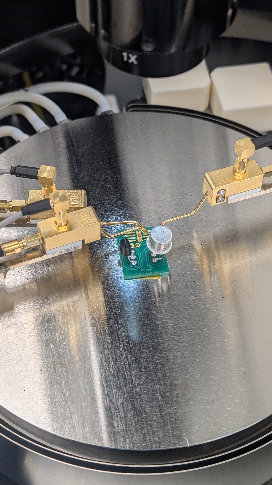
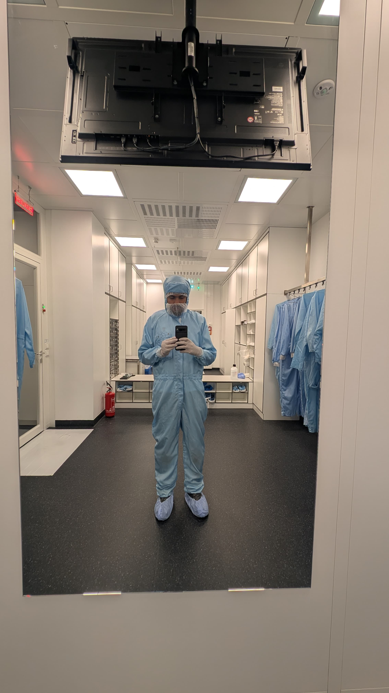
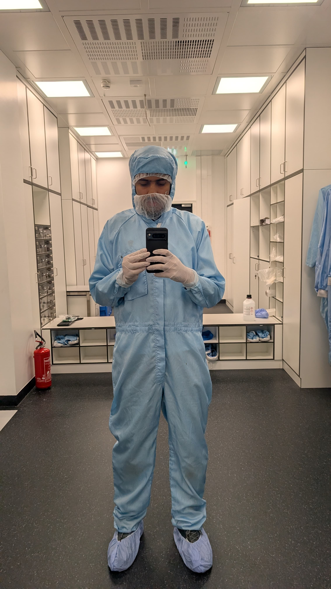
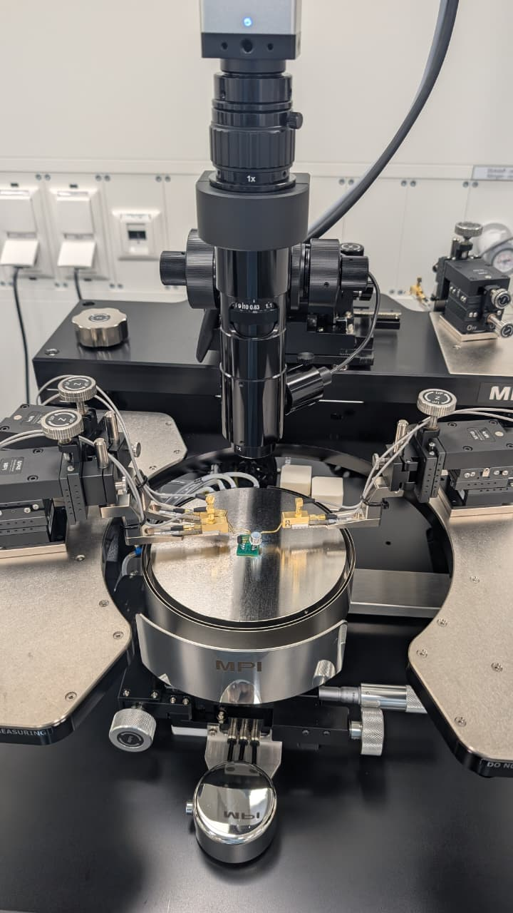
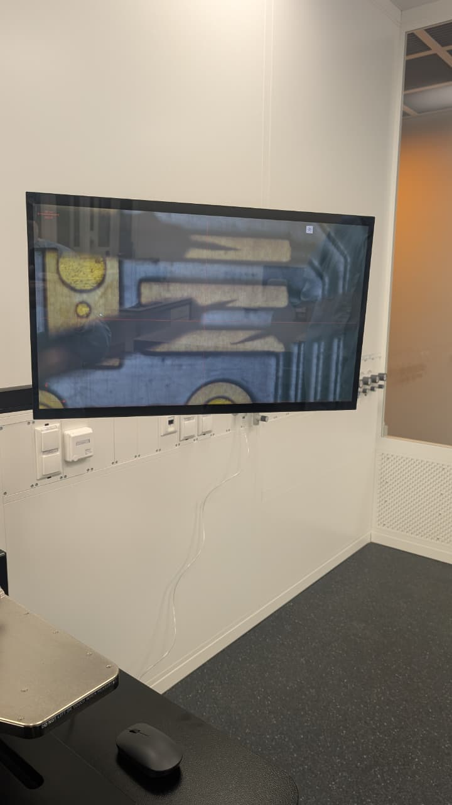
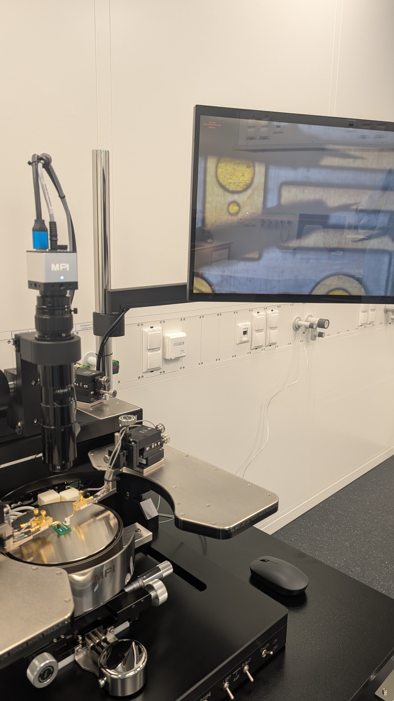
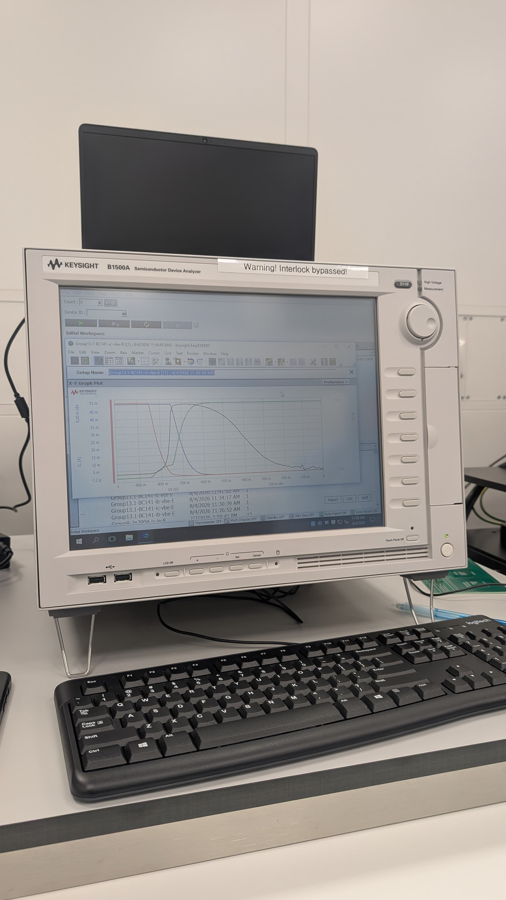
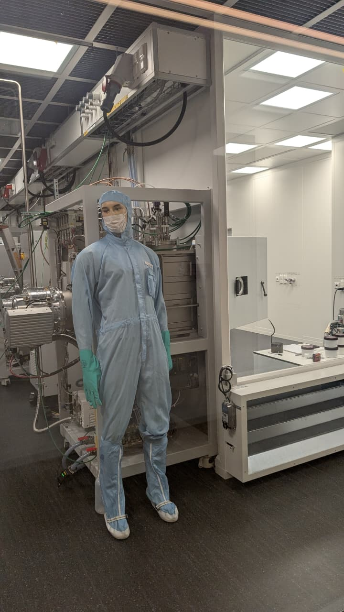

# BC141 BJT Characterization in a Cleanroom Laboratory

**Hands-on probe alignment, electrical contacting, and transistor characteristic measurements using an MPI probe station and Keysight B1500A.**



This university laboratory project investigated the electrical behavior of a **BC141 bipolar junction transistor**. I personally performed **probe alignment, electrical contacting, and BJT characteristic measurements**, connecting transistor theory with practical semiconductor testing.

All eight original laboratory photographs appear directly in this README alongside the setup and procedure.

## Objective

Observe how a transistor responds to applied electrical bias and understand the relationship between its terminal voltages and currents. The practical work involved accurate probe positioning, contact with the test fixture, and acquisition of characteristic readings using a semiconductor device analyzer.

## Device and equipment

| Item | Role |
|---|---|
| BC141 BJT | Transistor tested during the session |
| MPI probe station | Position the fixture and probe contacts |
| Probe micropositioners | Fine adjustment of the probe tips |
| Optical microscope and camera | Magnified observation of the contact region |
| Keysight B1500A Semiconductor Device Analyzer | Apply controlled electrical conditions and measure responses |
| EasyEXPERT | Instrument test interface and result display |
| Device test fixture | PCB-mounted devices and accessible contact pads |

The exact probe-station model and installed analyzer-module configuration are not established by the photographs.

## How I obtained the readings

The following sequence explains my confirmed alignment/contacting and measurement work using the photographed setup and the measurement principles covered in the course. Exact bias values, channel assignments, and the complete list of executed tests are not reconstructed without the original records.

### 1. Working in the cleanroom laboratory

I participated in the laboratory session wearing cleanroom attire. This provided the setting for practical work with semiconductor measurement equipment.




*Original photographs from the session. The documented work is electrical characterization; fabrication operations are outside its confirmed scope.*

### 2. Using the fixture and probe station

The device fixture was positioned beneath the microscope. Accessible pads provided electrical contact points, while the station and micropositioners supported controlled adjustment of the probes.



*The photograph shows a fixture with packaged components. BC141 is confirmed as a tested device; additional device identities are not inferred from the image.*

### 3. Observing the contact region

The microscope/camera displayed the contact area on a monitor. This magnified view made it possible to judge the positions of the probe tips relative to the pads during alignment.




*Optical feedback connects the physical probe adjustments with the small contact areas being measured.*

### 4. Aligning the probes and making contact

I adjusted the probe positions and established electrical contact with the fixture. This was a hands-on part of the experiment: the tips needed to reach the intended contact areas without bridging neighboring pads or damaging the sample.

The contacts provide electrical paths between the analyzer and the device terminals. Emitter, base, and collector assignments must correspond to the selected test configuration. The photographs do not establish the full terminal-to-channel mapping.

### 5. Applying bias and recording the response

I performed the BJT characteristic measurements using the analyzer setup. In this measurement method, the instrument applies controlled voltage or current and records the corresponding electrical response. EasyEXPERT organizes the test and displays its readings.

A **sweep** changes an input through a series of values. At each point, the analyzer measures the requested current or voltage. Another bias may be held constant or stepped to produce multiple curves.

For example, a common-emitter output measurement can sweep collector-emitter voltage while holding base current constant. Repeating this for other base currents produces a family of collector-current curves. This explains the measurement principle, rather than specifying the exact settings of the photographed run.

### 6. Viewing the characteristic curves

The analyzer displayed the readings as plots in EasyEXPERT. This original photograph documents the instrument and its displayed traces.



Each point represents a device response under a particular test condition. Correct interpretation requires the axis quantities, current/voltage sign conventions, swept variable, held or stepped bias, and measurement limits.

The photograph preserves the displayed result; it is not used to estimate numerical gain or resistance. The participant retains measurement data and a lab report, which are not included in this version.

### Measurement path


## Understanding the readings

The course covers the following measurement families. This table explains their meaning without asserting that every listed dataset is present in this repository.

| Measurement | Plotted relationship | Purpose |
|---|---|---|
| Common-emitter input | Base current versus base-emitter voltage | Examine input-junction behavior |
| Common-emitter transfer | Collector current versus base-emitter voltage | Examine collector response to input bias |
| Common-emitter output | Collector current versus collector-emitter voltage at controlled base drive | Examine output behavior |
| Gummel characteristic | Base and collector currents versus base-emitter voltage, using appropriate logarithmic current scaling | Compare current behavior over a broad range |
| Common-base input | Emitter current versus base-emitter voltage | Examine input behavior with a common base |
| Common-base transfer | Collector current versus base-emitter voltage | Examine transfer behavior |
| Common-base output | Collector current versus collector-base voltage | Examine output behavior with a common base |
| Common-base current transfer | Collector current versus emitter current | Compare input and output currents |

### Parameters associated with curve analysis

| Quantity | Meaning |
|---|---|
| DC common-emitter gain | `beta = I_C / I_B` at the same operating point |
| DC common-base gain | `alpha = I_C / I_E` with consistent current conventions |
| Differential input resistance | Local `dV_BE / dI_B` at fixed collector-emitter voltage |
| Differential output resistance | Local `dV_CE / dI_C` at fixed base current |
| Early-effect analysis | Examine the forward-active output slope and, when justified, its extrapolated voltage intercept |

These relationships explain how suitable readings relate to transistor parameters. No numerical parameter values are claimed without the corresponding data. See the [technical guide](docs/TECHNICAL_GUIDE.md) for further explanation.

## Laboratory environment



*Additional record of cleanroom participation. Operation of the background process equipment is not claimed.*

## Practical work documented

- Personally performed probe alignment and electrical contacting.
- Personally performed BJT characteristic measurements, with BC141 confirmed.
- Documented the MPI probe station, microscope system, and Keysight B1500A/EasyEXPERT setup.
- Preserved the original analyzer-screen photograph as visual evidence of the measurement setup.

## Course reference and actual setup

The supplied handout is **Transistor Characterization — Course Work**, Universität Siegen, Microelectronics. It describes BJT theory and a Keithley 4200-SCS/KITE procedure with other transistor examples.

The actual photographed equipment is **Keysight B1500A/EasyEXPERT**, and the confirmed tested device is **BC141**. The practical account uses this actual setup; the handout supplies theoretical context.

The course PDF contains laboratory access details and is not bundled. Its reference/simulation plots are not presented as personal measurements. See [source notes](docs/SOURCE_NOTES.md).

## Repository contents

```text
BJT-Device-Characterization-Lab/
|-- README.md                    Project, procedure and all photographs
|-- LICENSE-NOTICE.md
|-- docs/
|   |-- TECHNICAL_GUIDE.md
|   |-- SOURCE_NOTES.md
|   |-- ASSET_PROVENANCE.json
|   `-- images/                 Assets displayed directly in this README
|-- data/README.md               Measurement-record description
`-- results/README.md            Available result evidence
```

## References

- [Keysight B1500A](https://www.keysight.com/us/en/product/B1500A/semiconductor-device-parameter-analyzer-system-mainframe.html)
- [MPI semiconductor test systems](https://www.mpi-corporation.com/ast/)
- [Image provenance](docs/ASSET_PROVENANCE.json)
- [License and attribution](LICENSE-NOTICE.md)

Photographs retain their original content. The analyzer image includes an interlock warning label; it records the session and is not an instruction to reproduce that configuration. Follow the laboratory's approved equipment procedures.
